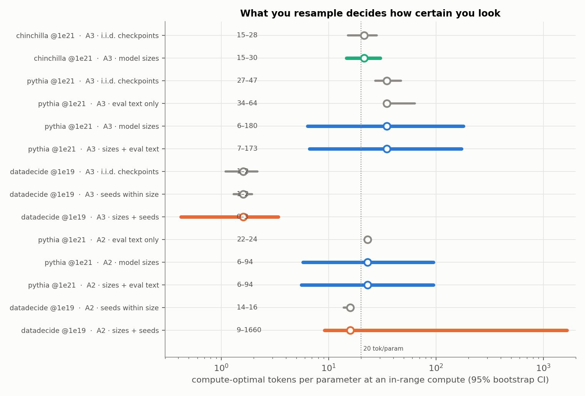
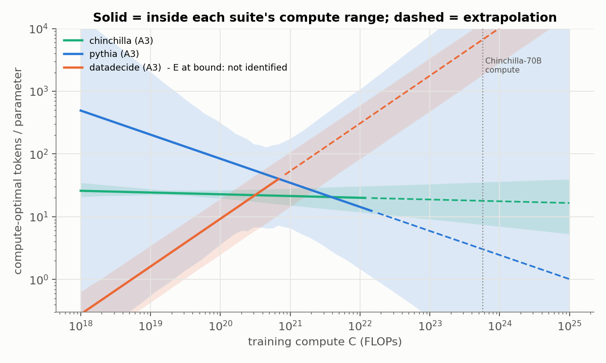
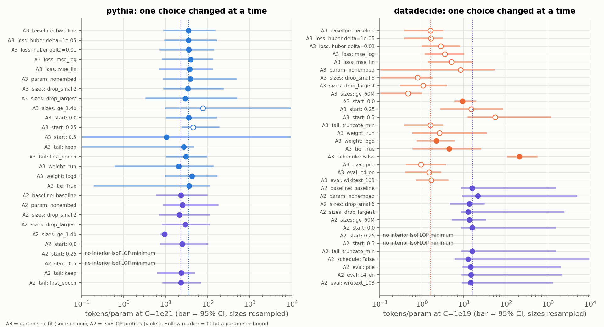
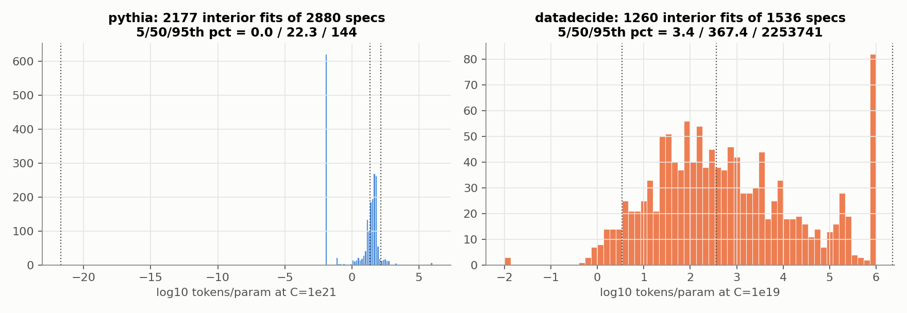
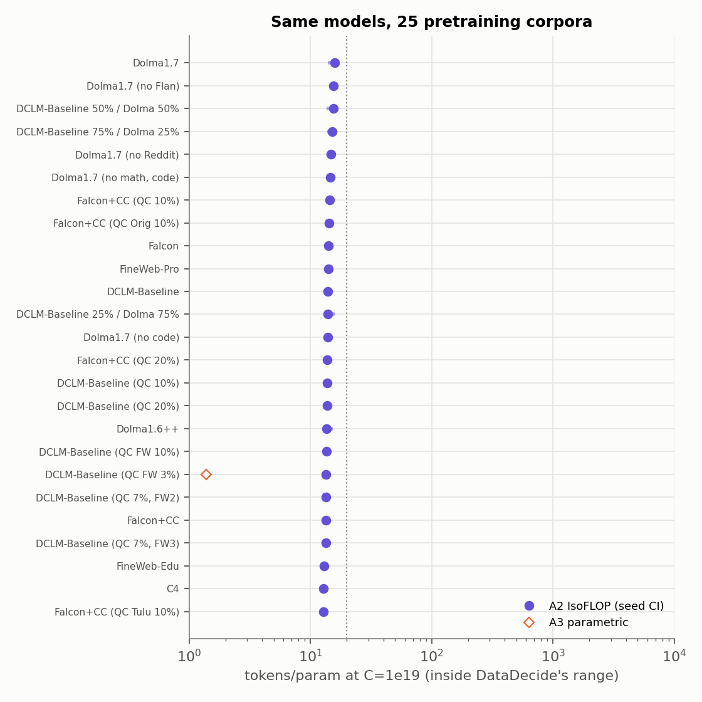

# Scaling-law fits with honest uncertainty

**How many training tokens per parameter is compute-optimal — and how sure can we be,
from public checkpoint suites?** This repo fits Chinchilla-style laws to the Pythia and
DataDecide (OLMo-codebase) suites with bootstrap intervals that resample the right unit, then
measures how far the answer moves under every defensible analyst choice.

> **Deliverable**
>
> * **Pythia-deduped, C = 10²¹ FLOPs:** compute-optimal tokens/param = **23**
>   [95% CI 6–94]
>   (IsoFLOP profiles; model sizes and evaluation text resampled). Restricting to models ≥ 1.4B
>   moves it by **-59%**.
> * **DataDecide / Dolma 1.7, C = 10¹⁹ FLOPs:** **16**
>   [95% CI 9–1,660;
>   seed noise alone 14–16].
>   Counting non-embedding instead of total parameters moves it by **+37%**;
>   by contrast, swapping the pretraining corpus (25 recipes) only moves it within 12.9–15.9.
> * **Chinchilla (Hoffmann et al. 2022, data as extracted by Besiroglu et al. 2024), C = 10²¹:**
>   **21** [15–28];
>   at Chinchilla-70B compute **18** [7–35].
>
> All three agree with "≈20 tokens/param" — but only because the intervals are wide, and only with
> the non-parametric IsoFLOP estimator. **The parametric Chinchilla fit (Approach 3) on the same
> checkpoints is not identified:** on DataDecide it returns 1.6 tokens/param
> with E pinned at its bound, and turning the LR-schedule correction off moves it to
> 209 (130×).

## Why this is hard

Chinchilla trained *separate* runs, each with a cosine schedule matched to its length. Public
suites instead release *intermediate checkpoints of one run per size*. Three consequences drive
everything below:

1. **A checkpoint is not a shorter run.** Mid-schedule the learning rate is still high, so loss sits
   above what an annealed run of the same length reaches. The DataDecide authors fit only final
   checkpoints for exactly this reason.
2. **In Pythia the confound is not even estimable.** Every Pythia run ends at the same 300B tokens,
   so run fraction f = D / 300B is a function of D alone: any schedule effect is absorbed into
   B·D<sup>−β</sup>. (DataDecide ends every run at 100 tokens/param, so f = D/100N, which is identifiable, but only weakly.)
3. **Checkpoints are not independent observations.** Consecutive checkpoints of one run share
   initialisation, data order and LR state. Bootstrapping them i.i.d. — the default in the
   literature — treats ~800 strongly correlated points as independent.

## Data

| Suite | What we use | Sizes | Points | Held-out loss |
|---|---|---|---|---|
| **Pythia-deduped** (Biderman et al. 2023) | per-sequence losses from Lesci et al. (2024), `pietrolesci/pythia-deduped-stats` | 70M–12B (7; no 1B released) | 144 ckpts × 1,700 Pile-val sequences, *identical text for every size* | Pile validation |
| **DataDecide** (Magnusson et al. 2025; OLMo codebase/ladder) | `allenai/DataDecide-ppl-results` | 4M–1B (14) × 25 corpora × up to 3 seeds | 1,100 runs | Dolma-CC val (baseline); Pile, C4, WikiText as alternatives |
| **Chinchilla** (Hoffmann et al. 2022) | 245 points digitised from Fig. 4 by Besiroglu et al. (2024) | 44M–16B | 240 (5 highest-loss dropped, as Besiroglu) | MassiveText |

Parameter counts are computed from each `config.json` and reproduce the Pythia paper's Table 1
and the DataDecide model card exactly (`tests/test_params.py`).

**Data verification.** The small Pythia-deduped models *degrade* late in training, which decides
which checkpoints a fit may use, so we re-measured it ourselves on a Pile-val sample (T1000 GPU,
`scripts/verify_pythia_losses.py`):

| size | steps | our Δloss | Lesci Δloss |
|---|---|---|---|
| 70M | 21k → 143k | +0.52 ± 0.06 | +2.49 |
| 160M | 55k → 143k | +0.28 ± 0.04 | +1.13 |
| 410M | 33k → 68k | -0.067 ± 0.002 | -0.041 |
| 410M | 68k → 143k | -0.038 ± 0.002 | +0.28 |
| 1.4B | 83k → 143k | -0.046 ± 0.002 | +0.13 |

Degradation is real for 70M/160M but the released data overstate it ~4–5×, and the late-run
*rise* the released data show for 410M and 1.4B does not reproduce (we measure a small decrease for both). Before the minimum
the two agree in direction and roughly in size (410M, 33k → 68k), with a near-constant level offset
from the different text sample. The baseline therefore
truncates each run at its smoothed loss minimum (`tail=truncate_min`); `tail=keep` is shown as a
sensitivity, and should be read as contaminated.

## Method

**Law.** L(N, D) = E + A N<sup>−α</sup> + B D<sup>−β</sup>, fitted as Hoffmann et al. / Besiroglu et al.: log-sum-exp
parameterisation, Huber loss (δ = 10⁻³) on log-residuals, L-BFGS-B refined from the best points of
the 4,500-point Hoffmann grid, analytic gradients (checked against finite differences).
Compute-optimal allocation under C = 6ND is closed-form; the ratio
r(C) = G<sup>−2</sup>(C/6)<sup>(α−β)/(α+β)</sup> **depends on C unless α = β**, so every number is quoted at a stated compute.

**Schedule-aware variant (DataDecide).** L + K·[η(f) − η(1)]/10⁻³, where η is the *absolute*
learning rate at run fraction f (cosine to 1% of peak, peak ∝ N<sup>−1/3</sup> per the OLMo ladder). The
term vanishes at the end of a run, so (E, A, B, α, β) describe annealed losses. Out-of-sample
check — fit on checkpoints with f ≤ 0.7, predict every run's final loss: log-MAE
0.033 → 0.015 (f ≤ 0.5:
0.043 → 0.031). It fails when only f ≤ 0.3 is seen
(LR barely varies; K unidentified), and is exactly zero on Pythia, as point 2 predicts.

**Two estimators.** *Approach 3*: the parametric law above. *Approach 2*: IsoFLOP profiles built
from checkpoints — interpolate each run's loss at fixed C, fit a parabola in log N around the
minimum, keep interior minima, fit N<sub>opt</sub> ∝ C<sup>a</sup>. Approach 2 makes no functional-form assumption
and only answers inside the compute range where ≥ 3 sizes overlap.

**Bootstrap — what is resampled.**

| scheme | unit | what it captures |
|---|---|---|
| `iid` | checkpoints | the literature default; ignores within-run correlation |
| `eval` | Pile-val sequences (paired across sizes) | measurement noise only |
| `seed` | seed-runs within each size | run-to-run training noise |
| `cluster` | model sizes | *which sizes happened to be trained* — the design |
| `cluster_eval`, `cluster_seed` | both | headline intervals |

**Coverage check (synthetic, known truth, Pythia design).** With independent noise both schemes
cover (i.i.d. 96%, cluster 92%). With realistic
correlated noise (AR(1) ρ = 0.95 along runs plus a per-run offset) the i.i.d. 95% interval covers the
true ratio only **64%** of the time, the size-cluster interval
94% (200 replicates × 200 resamples).

**Multiverse.** Seven (Pythia) / eight (DataDecide) choice axes — loss function, parameter
counting, which sizes, where the fit starts, tail handling, checkpoint weighting, α = β, schedule
term, evaluation set — run one-at-a-time with bootstrap CIs and as a full factorial
(2,880 + 1,536 specifications).

## Validation of the fitter

Reproducing Besiroglu et al. (2024) on their own data: E = 1.817,
A = 481.4, B = 2081,
α = 0.3477, β = 0.3658
vs published 1.817 / 482.0 / 2085 / 0.3478 / 0.3658. Matching requires Huber δ ≈ 10⁻⁵: their
scaled-Huber likelihood with a fitted scale σ is effectively a near-L1 fit — itself an undocumented fitting choice.
With Hoffmann's δ = 10⁻³ the ratio at Chinchilla compute is 17.9
vs 18.3.

Unit tests (`make test`): gradient checks for all objectives, noiseless parameter recovery,
closed-form vs numerical optimum, schedule-term recovery (and the bias of ignoring it), IsoFLOP
frontier recovery, exact parameter counts.

## Results



**Same data, same fit, different resampling unit.** For the Pythia parametric fit at 10²¹, i.i.d.
checkpoints give [27, 47], evaluation text alone
[34, 64], resampling model sizes
[7, 173].
Measurement noise is negligible; the uncertainty is in *which runs exist*.



**Extrapolation.** Because α ≠ β the ratio drifts with compute. Pythia's parametric fit gives
3 tokens/param at Chinchilla-70B compute with a 95% interval of
0.06–34,420: an extrapolation of ~30× beyond its largest run
carries essentially no information. DataDecide (largest run 7.7×10²⁰) is worse.

### What moves the answer



| suite · estimator | baseline | largest single-choice shift |
|---|---|---|
| Pythia · IsoFLOP (C=10²¹) | 23.1 | sizes → ge_1.4b: -59%; param +9%, tail +2%; fit start ≥ 0.25: no estimate |
| Pythia · parametric (C=10²¹) | 34.7 | sizes → ge_1.4b: +122%; fit start → 0.5: -70%; weighting → run: -41% |
| DataDecide · IsoFLOP (C=10¹⁹) | 15.9 | param → non-embedding: +37%; schedule off: -20%; eval set ≤ -9% |
| DataDecide · parametric (C=10¹⁹) | 1.6 | schedule off: ×130; fit start → 0.5: ×35; loss fn → mse_lin: ×3.2 |

Both IsoFLOP estimates fail outright (no interior minimum) when the fit starts at ≥ 25% of the run:
the compute ranges of different sizes stop overlapping.



**Full factorial (parametric fits).** Pythia: 2,177 of 2,880
specifications give an interior, converged fit; their median is 22 tokens/param with an
interquartile range of 2e-07–49, and only 30%
land within 2× of 20. DataDecide: 1,260 of 1,536; median
367, IQR 40–6,210, 13% within 2× of 20.
Ranked by the spread of per-level medians, the choices that matter are **fit start** and **tail handling** on Pythia
(tail: ×18), and **fit start**, **schedule term**
(×28) and **parameter counting** (×13) on DataDecide;
the loss function, which the Chinchilla replication debate focused on, is among the least important
(×1.7 / ×1.1).



**Data recipe.** Holding architecture, sizes and schedule fixed, the IsoFLOP ratio at 10¹⁹ ranges
only from 12.9 (Falcon+CC (QC Tulu 10%)) to 15.9 (Dolma1.7),
median 13.9, across all 25 corpora. Within this suite, corpus choice moves the answer less than counting
embedding parameters does. The parametric fit is at a bound for 92% of corpora.

## Conclusions

1. **Use IsoFLOP-style estimates, not the parametric law, on checkpoint suites.** The parametric fit
   trades E, B and β along a ridge (DataDecide: E → 0, β ≈ 0.04) and is hostage to the LR-schedule
   confound. The IsoFLOP estimator lands at 15–23 on both suites, consistent with Chinchilla's ~20,
   and moves by at most +37% under any single choice except dropping small Pythia models.
2. **Resample runs, not checkpoints.** On these suites, intervals that resample model sizes are
   6–40× wider (in log-width) than i.i.d.-checkpoint or measurement-only intervals, and on synthetic
   data with the same correlation structure the i.i.d. interval under-covers.
3. **Quote a compute.** With α ≠ β the ratio is a function of C, and outside the observed compute
   range the intervals are uninformative.
4. **Check the data.** The most consequential feature of the Pythia data (late-training rise)
   partly does not reproduce.

## Limitations

* Pythia has 7 sizes; with so few clusters the size bootstrap is itself approximate, and
  69% of resamples yield an interior IsoFLOP minimum (intervals are conditional on that).
* The schedule term assumes excess loss ∝ current LR with no lag (Tissue et al. 2024 model a lag);
  one global K. It is validated out-of-sample, not derived.
* Approach 2 from checkpoints still inherits schedule bias in Pythia (not correctable — see above).
* Our Pythia re-measurement covers 70M–1.4B on 200 × 2,048-token chunks; it tests the *shape* of the
  released curves, not their absolute level, and does not cover the 2.8B–12B models.
  Lesci et al. did not release a 1B split, so the suite has 7 sizes.
* C = 6ND ignores attention FLOPs; DataDecide's small models (d = 64–208) are embedding-dominated,
  which is why parameter counting matters so much there.

## Reproduce

```bash
make data      # ~600 MB public downloads
make build     # tidy tables in data/processed
make test
make all       # ~3 h on 24 cores (B = 1000 headline, 200 per OAT spec, full factorial, coverage sim)
make verify    # optional, GPU: re-measure Pythia losses
make check     # README numbers == results/
```

Layout: `src/scalingci/{law,spec,uncertainty,isoflop,multiverse,params,data,plots}.py`;
`scripts/` drive the analysis; every number above is rendered from `results/metrics.json` and
`results/derived.json` by `scripts/render_readme.py`.

## References

Hoffmann et al. 2022, *Training Compute-Optimal LLMs* · Besiroglu, Erdil, Barnett, You 2024,
*Chinchilla Scaling: A Replication Attempt* · Biderman et al. 2023, *Pythia* · Lesci et al. 2024,
*Causal Estimation of Memorisation Profiles* · Magnusson et al. 2025, *DataDecide* · Porian et al.
2024, *Resolving Discrepancies in Compute-Optimal Scaling* · Pearce & Song 2024, *Reconciling
Kaplan and Chinchilla* · Tissue et al. 2024, *Scaling Law with LR Annealing* · Hägele et al. 2024,
*Scaling Laws and Compute-Optimal Training Beyond Fixed Training Durations*.
