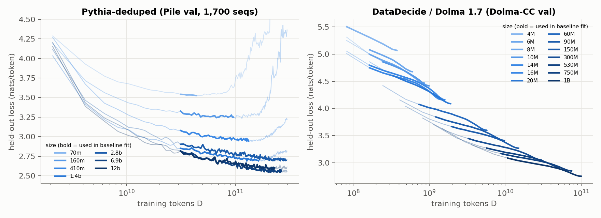
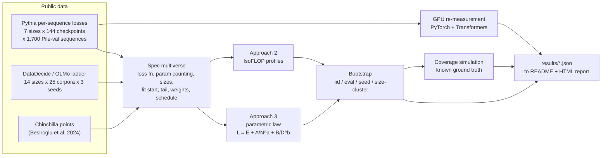
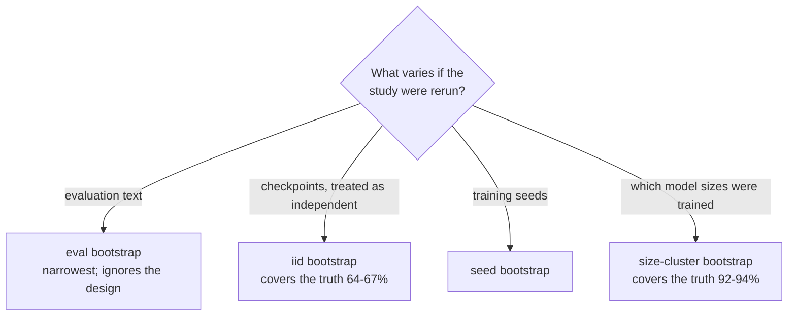
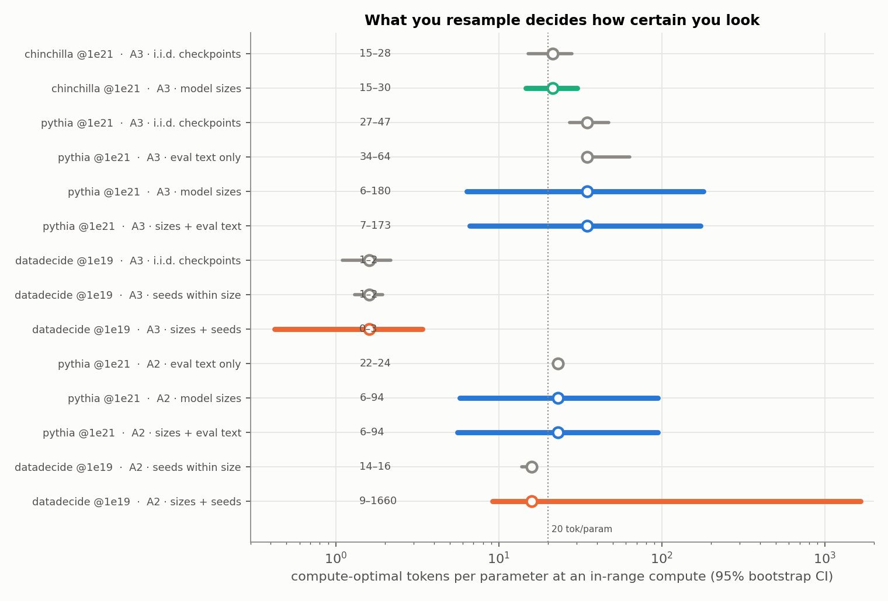
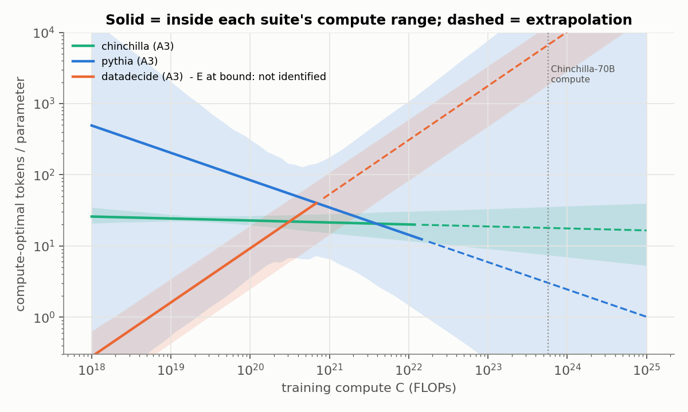
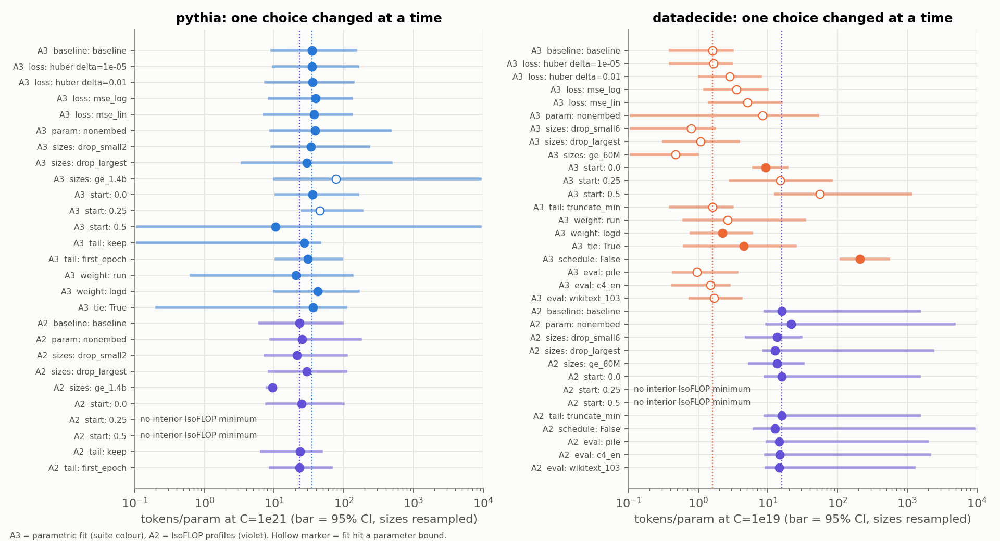
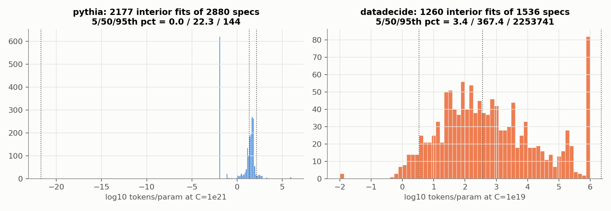
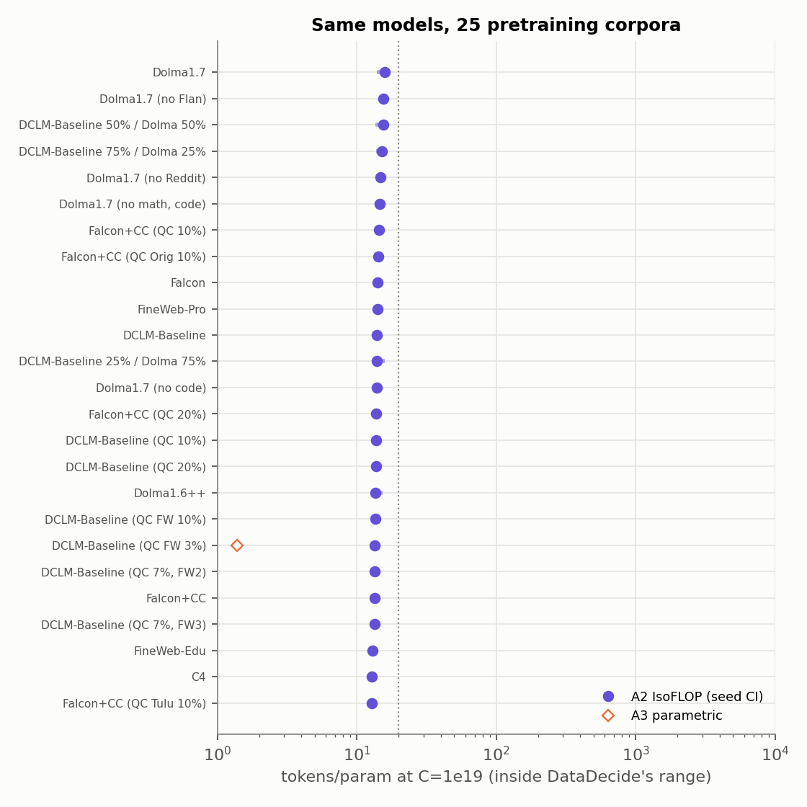

# LLM Scaling Laws: Compute-Optimal Training with Bootstrap Uncertainty


**Statistical analysis of large language model (LLM) scaling laws.** This project fits Chinchilla-style
neural scaling laws to the **Pythia**, **OLMo / DataDecide** and **Chinchilla** model suites, puts
**bootstrap confidence intervals** on the compute-optimal tokens-per-parameter ratio, and measures how far
that answer moves under **4,400+ alternative analysis choices** (multiverse / specification-curve analysis).
It also re-measures the published Pythia training losses on a GPU with PyTorch and Hugging Face Transformers,
and finds that part of the released data does not reproduce.

**Question:** how many training tokens per model parameter is compute-optimal, and how sure can we be,
using only public checkpoint suites?

---

## Key results

| Model suite | Compute budget | Compute-optimal tokens / parameter | 95% confidence interval | Largest single-choice shift |
|---|---|---|---|---|
| **Pythia** (EleutherAI, 70M–12B) | 10²¹ FLOPs | **{{m.approach2.pythia.point.C=1e21:.0f}}** | {{m.approach2.pythia.boot.cluster_eval.C=1e21.lo:.0f}}–{{m.approach2.pythia.boot.cluster_eval.C=1e21.hi:.0f}} | only models ≥ 1.4B: **{{d.oat.pythia_A2.axes.sizes.max_pct:pct}}** |
| **OLMo / DataDecide** (AI2, Dolma 1.7, 4M–1B) | 10¹⁹ FLOPs | **{{m.approach2.datadecide.point.C=1e19:.0f}}** | {{m.approach2.datadecide.boot.cluster_seed.C=1e19.lo:.0f}}–{{m.approach2.datadecide.boot.cluster_seed.C=1e19.hi:sig2}} (seeds only {{m.approach2.datadecide.boot.seed.C=1e19.lo:.0f}}–{{m.approach2.datadecide.boot.seed.C=1e19.hi:.0f}}) | non-embedding params: **{{d.oat.datadecide_A2.axes.param.max_pct:pct}}** |
| **Chinchilla** (DeepMind, 44M–16B) | 10²¹ FLOPs | **{{m.approach3.chinchilla.point.C=1e21:.0f}}** | {{m.approach3.chinchilla.boot.iid.C=1e21.lo:.0f}}–{{m.approach3.chinchilla.boot.iid.C=1e21.hi:.0f}} | — |

**Findings**

1. **All three suites agree with "≈ 20 tokens per parameter"**, but only because the honest intervals are wide.
2. **The usual bootstrap overstates certainty.** On synthetic data with a known answer, resampling checkpoints
   i.i.d. gives a 95% interval that contains the truth only **{{d.coverage.4.coverage:.0%}}** of the time;
   resampling whole model sizes gives **{{d.coverage.5.coverage:.0%}}**.
3. **The parametric Chinchilla fit is not identified on checkpoint suites.** On DataDecide it returns
   {{m.approach3.datadecide.point.C=1e19:.1f}} tokens/param, and switching off the learning-rate-schedule term
   moves it **×{{d.oat.datadecide_A3.axes.schedule.factor:.0f}}**. The IsoFLOP estimator (Chinchilla Approach 2) is stable.
4. **Analyst choices matter more than the loss function.** Where the fit starts and how late-training data are
   handled move the answer up to ×{{d.factorial.main_effects.pythia.tail:.0f}}; the loss function, the focus of the
   2024 Chinchilla replication debate, moves it ×{{d.factorial.main_effects.pythia.loss:.1f}}.
5. **The released Pythia losses partly don't reproduce.** Our GPU re-measurement finds late-training degradation
   overstated ~4–5× for 70M/160M, and no late rise at all for 410M and 1.4B.
6. **Pretraining data matter less than parameter counting.** Across 25 corpora the ratio stays within
   {{d.corpora.A2_min:.1f}}–{{d.corpora.A2_max:.1f}}.



---

## Pipeline



**Which bootstrap unit, and why it matters:**



---

## Skills and tools demonstrated

- **Statistics and uncertainty quantification:** nonparametric and cluster bootstrap, confidence intervals,
  Monte Carlo coverage simulation, jackknife, robust regression (Huber loss), multiverse / specification-curve analysis.
- **Optimization and modeling:** nonlinear least squares with L-BFGS-B, analytic gradients, log-sum-exp
  parameterisation, grid-search initialisation, closed-form compute-optimal allocation, parameter identifiability.
- **Machine learning research:** neural scaling laws, Chinchilla compute-optimal training, IsoFLOP analysis,
  learning-rate-schedule effects, LLM evaluation (perplexity / cross-entropy loss).
- **Deep learning engineering:** PyTorch and Hugging Face Transformers GPU inference over model checkpoints,
  exact parameter counting from model configs (GPT-NeoX, OLMo).
- **Data engineering:** Hugging Face Hub datasets, Parquet / pandas pipelines, NumPy data cubes, data validation.
- **Software engineering:** Python package layout, pytest (31 tests: gradient checks, parameter recovery),
  multiprocessing, Makefile pipeline, templated reports where every number comes from the results files (`make check`).
- **Visualization and communication:** Matplotlib figures, a colour-blind-checked palette, a self-contained HTML report.

**Tech stack:** Python · NumPy · SciPy · pandas · PyArrow · Matplotlib · PyTorch · Hugging Face Transformers · pytest · Make

---

## Contents

[Why this is hard](#why-this-is-hard) · [Data](#data) · [Method](#method) ·
[Validation](#validation-of-the-fitter) · [Results](#results) · [Conclusions](#conclusions) ·
[Limitations](#limitations) · [Reproduce](#reproduce) · [References](#references)

An interactive version of the report with all figures is in [`web/report.html`](web/report.html) (download it and open it in a browser).

## Why this is hard

Chinchilla trained *separate* runs, each with a cosine schedule matched to its length. Public
suites instead release *intermediate checkpoints of one run per size*. Three consequences drive
everything below:

1. **A checkpoint is not a shorter run.** Mid-schedule the learning rate is still high, so loss sits
   above what an annealed run of the same length reaches. The DataDecide authors fit only final
   checkpoints for exactly this reason.
2. **In Pythia the confound is not even estimable.** Every Pythia run ends at the same 300B tokens,
   so run fraction f = D / 300B is a function of D alone: any schedule effect is absorbed into
   B·D<sup>−β</sup>. (DataDecide ends every run at 100 tokens/param, so f = D/100N, which is identifiable, but only weakly.)
3. **Checkpoints are not independent observations.** Consecutive checkpoints of one run share
   initialisation, data order and LR state. Bootstrapping them i.i.d. — the default in the
   literature — treats ~800 strongly correlated points as independent.

## Data

| Suite | What we use | Sizes | Points | Held-out loss |
|---|---|---|---|---|
| **Pythia-deduped** (Biderman et al. 2023) | per-sequence losses from Lesci et al. (2024), `pietrolesci/pythia-deduped-stats` | 70M–12B (7; no 1B released) | 144 ckpts × 1,700 Pile-val sequences, *identical text for every size* | Pile validation |
| **DataDecide** (Magnusson et al. 2025; OLMo codebase/ladder) | `allenai/DataDecide-ppl-results` | 4M–1B (14) × 25 corpora × up to 3 seeds | 1,100 runs | Dolma-CC val (baseline); Pile, C4, WikiText as alternatives |
| **Chinchilla** (Hoffmann et al. 2022) | 245 points digitised from Fig. 4 by Besiroglu et al. (2024) | 44M–16B | 240 (5 highest-loss dropped, as Besiroglu) | MassiveText |

Parameter counts are computed from each `config.json` and reproduce the Pythia paper's Table 1
and the DataDecide model card exactly (`tests/test_params.py`).

**Data verification.** The small Pythia-deduped models *degrade* late in training, which decides
which checkpoints a fit may use, so we re-measured it ourselves on a Pile-val sample (T1000 GPU,
`scripts/verify_pythia_losses.py`):

| size | steps | our Δloss | Lesci Δloss |
|---|---|---|---|
| 70M | 21k → 143k | {{d.verification.0.ours_delta:+.2f}} ± {{d.verification.0.ours_delta_se:.2f}} | {{d.verification.0.lesci_delta:+.2f}} |
| 160M | 55k → 143k | {{d.verification.1.ours_delta:+.2f}} ± {{d.verification.1.ours_delta_se:.2f}} | {{d.verification.1.lesci_delta:+.2f}} |
| 410M | 33k → 68k | {{d.verification.3.ours_delta:+.3f}} ± {{d.verification.3.ours_delta_se:.3f}} | {{d.verification.3.lesci_delta:+.3f}} |
| 410M | 68k → 143k | {{d.verification.2.ours_delta:+.3f}} ± {{d.verification.2.ours_delta_se:.3f}} | {{d.verification.2.lesci_delta:+.2f}} |
| 1.4B | 83k → 143k | {{d.verification.4.ours_delta:+.3f}} ± {{d.verification.4.ours_delta_se:.3f}} | {{d.verification.4.lesci_delta:+.2f}} |

Degradation is real for 70M/160M but the released data overstate it ~4–5×, and the late-run
*rise* the released data show for 410M and 1.4B does not reproduce (we measure a small decrease for both). Before the minimum
the two agree in direction and roughly in size (410M, 33k → 68k), with a near-constant level offset
from the different text sample. The baseline therefore
truncates each run at its smoothed loss minimum (`tail=truncate_min`); `tail=keep` is shown as a
sensitivity, and should be read as contaminated.

## Method

**Law.** L(N, D) = E + A N<sup>−α</sup> + B D<sup>−β</sup>, fitted as Hoffmann et al. / Besiroglu et al.: log-sum-exp
parameterisation, Huber loss (δ = 10⁻³) on log-residuals, L-BFGS-B refined from the best points of
the 4,500-point Hoffmann grid, analytic gradients (checked against finite differences).
Compute-optimal allocation under C = 6ND is closed-form; the ratio
r(C) = G<sup>−2</sup>(C/6)<sup>(α−β)/(α+β)</sup> **depends on C unless α = β**, so every number is quoted at a stated compute.

**Schedule-aware variant (DataDecide).** L + K·[η(f) − η(1)]/10⁻³, where η is the *absolute*
learning rate at run fraction f (cosine to 1% of peak, peak ∝ N<sup>−1/3</sup> per the OLMo ladder). The
term vanishes at the end of a run, so (E, A, B, α, β) describe annealed losses. Out-of-sample
check — fit on checkpoints with f ≤ 0.7, predict every run's final loss: log-MAE
{{d.schedule_oos.4.final_mae_log:.3f}} → {{d.schedule_oos.5.final_mae_log:.3f}} (f ≤ 0.5:
{{d.schedule_oos.2.final_mae_log:.3f}} → {{d.schedule_oos.3.final_mae_log:.3f}}). It fails when only f ≤ 0.3 is seen
(LR barely varies; K unidentified), and is exactly zero on Pythia, as point 2 predicts.

**Two estimators.** *Approach 3*: the parametric law above. *Approach 2*: IsoFLOP profiles built
from checkpoints — interpolate each run's loss at fixed C, fit a parabola in log N around the
minimum, keep interior minima, fit N<sub>opt</sub> ∝ C<sup>a</sup>. Approach 2 makes no functional-form assumption
and only answers inside the compute range where ≥ 3 sizes overlap.

**Bootstrap — what is resampled.**

| scheme | unit | what it captures |
|---|---|---|
| `iid` | checkpoints | the literature default; ignores within-run correlation |
| `eval` | Pile-val sequences (paired across sizes) | measurement noise only |
| `seed` | seed-runs within each size | run-to-run training noise |
| `cluster` | model sizes | *which sizes happened to be trained* — the design |
| `cluster_eval`, `cluster_seed` | both | headline intervals |

**Coverage check (synthetic, known truth, Pythia design).** With independent noise both schemes
cover (i.i.d. {{d.coverage.0.coverage:.0%}}, cluster {{d.coverage.1.coverage:.0%}}). With realistic
correlated noise (AR(1) ρ = 0.95 along runs plus a per-run offset) the i.i.d. 95% interval covers the
true ratio only **{{d.coverage.4.coverage:.0%}}** of the time, the size-cluster interval
{{d.coverage.5.coverage:.0%}} ({{d.coverage.0.reps:.0f}} replicates × {{d.coverage.0.B:.0f}} resamples).

**Multiverse.** Seven (Pythia) / eight (DataDecide) choice axes — loss function, parameter
counting, which sizes, where the fit starts, tail handling, checkpoint weighting, α = β, schedule
term, evaluation set — run one-at-a-time with bootstrap CIs and as a full factorial
({{d.factorial.pythia.n_specs:,}} + {{d.factorial.datadecide.n_specs:,}} specifications).

## Validation of the fitter

Reproducing Besiroglu et al. (2024) on their own data: E = {{m.approach3.chinchilla.besiroglu_repro_delta1e-5.E:.3f}},
A = {{m.approach3.chinchilla.besiroglu_repro_delta1e-5.A:.1f}}, B = {{m.approach3.chinchilla.besiroglu_repro_delta1e-5.B:.0f}},
α = {{m.approach3.chinchilla.besiroglu_repro_delta1e-5.alpha:.4f}}, β = {{m.approach3.chinchilla.besiroglu_repro_delta1e-5.beta:.4f}}
vs published 1.817 / 482.0 / 2085 / 0.3478 / 0.3658. Matching requires Huber δ ≈ 10⁻⁵: their
scaled-Huber likelihood with a fitted scale σ is effectively a near-L1 fit — itself an undocumented fitting choice.
With Hoffmann's δ = 10⁻³ the ratio at Chinchilla compute is {{m.approach3.chinchilla.point.C=5~76e23:.1f}}
vs {{m.approach3.chinchilla.besiroglu_repro_delta1e-5.C=5~76e23:.1f}}.

Unit tests (`make test`): gradient checks for all objectives, noiseless parameter recovery,
closed-form vs numerical optimum, schedule-term recovery (and the bias of ignoring it), IsoFLOP
frontier recovery, exact parameter counts.

## Results



**Same data, same fit, different resampling unit.** For the Pythia parametric fit at 10²¹, i.i.d.
checkpoints give [{{m.approach3.pythia.boot.iid.C=1e21.lo:.0f}}, {{m.approach3.pythia.boot.iid.C=1e21.hi:.0f}}], evaluation text alone
[{{m.approach3.pythia.boot.eval.C=1e21.lo:.0f}}, {{m.approach3.pythia.boot.eval.C=1e21.hi:.0f}}], resampling model sizes
[{{m.approach3.pythia.boot.cluster_eval.C=1e21.lo:.0f}}, {{m.approach3.pythia.boot.cluster_eval.C=1e21.hi:.0f}}].
Measurement noise is negligible; the uncertainty is in *which runs exist*.



**Extrapolation.** Because α ≠ β the ratio drifts with compute. Pythia's parametric fit gives
{{m.approach3.pythia.point.C=5~76e23:.0f}} tokens/param at Chinchilla-70B compute with a 95% interval of
{{m.approach3.pythia.boot.cluster_eval.C=5~76e23.lo:.2f}}–{{m.approach3.pythia.boot.cluster_eval.C=5~76e23.hi:sig2}}: an extrapolation of ~30× beyond its largest run
carries essentially no information. DataDecide (largest run 7.7×10²⁰) is worse.

### What moves the answer



| suite · estimator | baseline | largest single-choice shift |
|---|---|---|
| Pythia · IsoFLOP (C=10²¹) | {{d.oat.pythia_A2.baseline:.1f}} | sizes → {{d.oat.pythia_A2.axes.sizes.value}}: {{d.oat.pythia_A2.axes.sizes.max_pct:pct}}; param {{d.oat.pythia_A2.axes.param.max_pct:pct}}, tail {{d.oat.pythia_A2.axes.tail.max_pct:pct}}; fit start ≥ 0.25: no estimate |
| Pythia · parametric (C=10²¹) | {{d.oat.pythia_A3.baseline:.1f}} | sizes → {{d.oat.pythia_A3.axes.sizes.value}}: {{d.oat.pythia_A3.axes.sizes.max_pct:pct}}; fit start → {{d.oat.pythia_A3.axes.start.value}}: {{d.oat.pythia_A3.axes.start.max_pct:pct}}; weighting → {{d.oat.pythia_A3.axes.weight.value}}: {{d.oat.pythia_A3.axes.weight.max_pct:pct}} |
| DataDecide · IsoFLOP (C=10¹⁹) | {{d.oat.datadecide_A2.baseline:.1f}} | param → non-embedding: {{d.oat.datadecide_A2.axes.param.max_pct:pct}}; schedule off: {{d.oat.datadecide_A2.axes.schedule.max_pct:pct}}; eval set ≤ {{d.oat.datadecide_A2.axes.eval.max_pct:pct}} |
| DataDecide · parametric (C=10¹⁹) | {{d.oat.datadecide_A3.baseline:.1f}} | schedule off: ×{{d.oat.datadecide_A3.axes.schedule.factor:.0f}}; fit start → {{d.oat.datadecide_A3.axes.start.value}}: ×{{d.oat.datadecide_A3.axes.start.factor:.0f}}; loss fn → {{d.oat.datadecide_A3.axes.loss.value}}: ×{{d.oat.datadecide_A3.axes.loss.factor:.1f}} |

Both IsoFLOP estimates fail outright (no interior minimum) when the fit starts at ≥ 25% of the run:
the compute ranges of different sizes stop overlapping.



**Full factorial (parametric fits).** Pythia: {{d.factorial.pythia.n_interior:,}} of {{d.factorial.pythia.n_specs:,}}
specifications give an interior, converged fit; their median is {{d.factorial.pythia.q50:.0f}} tokens/param with an
interquartile range of {{d.factorial.pythia.q25:.1g}}–{{d.factorial.pythia.q75:.0f}}, and only {{d.factorial.pythia.frac_within_2x_of_20:.0%}}
land within 2× of 20. DataDecide: {{d.factorial.datadecide.n_interior:,}} of {{d.factorial.datadecide.n_specs:,}}; median
{{d.factorial.datadecide.q50:,.0f}}, IQR {{d.factorial.datadecide.q25:.0f}}–{{d.factorial.datadecide.q75:,.0f}}, {{d.factorial.datadecide.frac_within_2x_of_20:.0%}} within 2× of 20.
Ranked by the spread of per-level medians, the choices that matter are **fit start** and **tail handling** on Pythia
(tail: ×{{d.factorial.main_effects.pythia.tail:.0f}}), and **fit start**, **schedule term**
(×{{d.factorial.main_effects.datadecide.schedule:.0f}}) and **parameter counting** (×{{d.factorial.main_effects.datadecide.param:.0f}}) on DataDecide;
the loss function, which the Chinchilla replication debate focused on, is among the least important
(×{{d.factorial.main_effects.pythia.loss:.1f}} / ×{{d.factorial.main_effects.datadecide.loss:.1f}}).



**Data recipe.** Holding architecture, sizes and schedule fixed, the IsoFLOP ratio at 10¹⁹ ranges
only from {{d.corpora.A2_min:.1f}} ({{d.corpora.A2_argmin}}) to {{d.corpora.A2_max:.1f}} ({{d.corpora.A2_argmax}}),
median {{d.corpora.A2_median:.1f}}, across all 25 corpora. Within this suite, corpus choice moves the answer less than counting
embedding parameters does. The parametric fit is at a bound for {{d.corpora.A3_frac_at_bound:.0%}} of corpora.

## Conclusions

1. **Use IsoFLOP-style estimates, not the parametric law, on checkpoint suites.** The parametric fit
   trades E, B and β along a ridge (DataDecide: E → 0, β ≈ 0.04) and is hostage to the LR-schedule
   confound. The IsoFLOP estimator lands at 15–23 on both suites, consistent with Chinchilla's ~20,
   and moves by at most {{d.oat.datadecide_A2.axes.param.max_pct:pct}} under any single choice except dropping small Pythia models.
2. **Resample runs, not checkpoints.** On these suites, intervals that resample model sizes are
   6–40× wider (in log-width) than i.i.d.-checkpoint or measurement-only intervals, and on synthetic
   data with the same correlation structure the i.i.d. interval under-covers.
3. **Quote a compute.** With α ≠ β the ratio is a function of C, and outside the observed compute
   range the intervals are uninformative.
4. **Check the data.** The most consequential feature of the Pythia data (late-training rise)
   partly does not reproduce.

## Limitations

* Pythia has 7 sizes; with so few clusters the size bootstrap is itself approximate, and
  {{m.approach2.pythia.boot.cluster_eval.valid_frac:.0%}} of resamples yield an interior IsoFLOP minimum (intervals are conditional on that).
* The schedule term assumes excess loss ∝ current LR with no lag (Tissue et al. 2024 model a lag);
  one global K. It is validated out-of-sample, not derived.
* Approach 2 from checkpoints still inherits schedule bias in Pythia (not correctable — see above).
* Our Pythia re-measurement covers 70M–1.4B on 200 × 2,048-token chunks; it tests the *shape* of the
  released curves, not their absolute level, and does not cover the 2.8B–12B models.
  Lesci et al. did not release a 1B split, so the suite has 7 sizes.
* C = 6ND ignores attention FLOPs; DataDecide's small models (d = 64–208) are embedding-dominated,
  which is why parameter counting matters so much there.

## Reproduce

```bash
make data      # ~600 MB public downloads
make build     # tidy tables in data/processed
make test
make all       # ~3 h on 24 cores (B = 1000 headline, 200 per OAT spec, full factorial, coverage sim)
make verify    # optional, GPU: re-measure Pythia losses
make check     # README numbers == results/
```

Layout: `src/scalingci/{law,spec,uncertainty,isoflop,multiverse,params,data,plots}.py`;
`scripts/` drive the analysis; every number above is rendered from `results/metrics.json` and
`results/derived.json` by `scripts/render_readme.py`.

## References

Hoffmann et al. 2022, *Training Compute-Optimal LLMs* · Besiroglu, Erdil, Barnett, You 2024,
*Chinchilla Scaling: A Replication Attempt* · Biderman et al. 2023, *Pythia* · Lesci et al. 2024,
*Causal Estimation of Memorisation Profiles* · Magnusson et al. 2025, *DataDecide* · Porian et al.
2024, *Resolving Discrepancies in Compute-Optimal Scaling* · Pearce & Song 2024, *Reconciling
Kaplan and Chinchilla* · Tissue et al. 2024, *Scaling Law with LR Annealing* · Hägele et al. 2024,
*Scaling Laws and Compute-Optimal Training Beyond Fixed Training Durations*.
